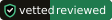

<p align="center"></p>

<h1 align="center">Vetted</h1>

<p align="center"><a href="https://fyclamitydestiny.github.io/vetted/">Website</a> · <a href="https://github.com/FYClamityDestiny/vetted/issues/new?template=review-request.yml">Request a human review ($5)</a></p>

**Find open-source tools and check them for malware before you install.** A Claude Code plugin.

You say what you need. Vetted searches eight sources, downloads the top candidates **without running them**, scans each one, rates it, and installs the one you pick, pinned to the exact version it scanned.

| Source | Finds |
|---|---|
| GitHub | repos, apps, Claude plugins |
| Hugging Face | models, datasets, Spaces |
| npm / PyPI | JavaScript and Python packages |
| Docker Hub | self-hosted app images |
| VS Code Marketplace / Open VSX | editor extensions |
| MCP registry, Smithery, Glama | MCP servers for Claude |
| Roblox Creator Store | models and plugins (catches `require(id)` backdoors) |

## Install

```bash
claude plugin marketplace add FYClamityDestiny/vetted
claude plugin install vetted
```

## Requirements

- **Node 18+** (for `scripts/vetted.mjs`, which fetches and condenses registry data, cached for 24h)
- **`gh`** signed in (recommended; without it GitHub allows 60 API requests an hour)
- Optional: **Docker** for sandbox installs, **`VT_API_KEY`** (a free VirusTotal key; only file fingerprints are sent), and the scanners listed below

## Skills

| Command | What it does |
|---|---|
| `/vetted:find <what you need>` | Search → scan → compare → install after you say yes |
| `/vetted:report <name>[, <name>…]` | Fact sheet: author, license, activity, contents, install, safety. Works on many at once. |
| `/vetted:digest [topic]` | What's new in your interests. Good as a weekly scheduled task. |
| `/vetted:update [name\|all]` | Updates what you installed, scans only what changed, and warns about bad news: archived, deprecated, ownership change, shutting down, license change |
| `/vetted:uninstall <name>` | Removes it and what it left behind (config, containers, volumes), then tells you which keys to revoke |
| `/vetted:share [name]` | Look up or contribute shared ratings (opt-in, by pull request) |

## How the safety check works

1. **Download, don't run.** Packages come straight from the registry as files. No `npm install`, no `pip download` (that runs `setup.py`), no Play mode in Studio.
2. **Pattern scan** (`scripts/scan.sh`) flags:
   - **Block:** a downloaded script piped into a shell, hidden code decoded and run, code that reads SSH keys, browser passwords or crypto wallets, Discord or Telegram webhooks used to send data out, reverse shells, startup persistence or turning off antivirus, crypto miners, Roblox `require(<id>)` and `loadstring`.
   - **Warn:** install scripts, shell access, raw IP addresses, large encoded blobs, bundled binaries, pickle model files, prompt-injection text in MCP tools, Claude hooks.
3. **Real malware scanners** if installed: Windows Defender, ClamAV, GuardDog (npm/PyPI), osv-scanner (known vulnerabilities), modelscan (ML models).
4. **Claude reads every flagged line and every entry point** (install scripts, main files, hooks, MCP tool descriptions), and checks trust signals: account age, whether the published package matches its source, recent ownership changes, typosquat names.
5. **Rating:** ✅ Clean · ⚠️ Review · ❔ Unverified · ⛔ Block. ✅ is only possible if a real malware scanner ran. ⛔ never installs. ⚠️ and ❔ need a second yes.
6. **Pinned install** of the exact commit, version, digest or asset ID that was scanned.

**Newer checks:**
- **Every dependency:** the full tree is resolved with deps.dev (nothing installed) and checked against OSV's known-malware (`MAL-`) and vulnerability lists.
- **Capability profile:** what the code can do (network, running programs, files, secrets, install hooks). `update` warns when a new version gains one.
- **Delayed payloads:** flags code that fetches and runs things, long timers and date triggers.
- **Scrambled code:** minified or packed files are flagged and unpacked before review; binaries are fingerprinted.
- **Sandbox (optional, Docker):** installs npm and PyPI packages with the network cut off and reports what they tried to do.
- **Quality grade A–F** from OpenSSF Scorecard, kept separate from the safety rating.

**Honest limits:** Vetted lowers the risk; it can't rule it out. Well-hidden or time-delayed malware can get past any scanner. Install a real malware scanner for best results, and only install what you need.

## Human review and badge

For $5 per version, a person reviews your repo and you get the badge, linked to a public record in `ratings/`:



[Request a review](https://github.com/FYClamityDestiny/vetted/issues/new?template=review-request.yml). A review covers one version and is an opinion, not a guarantee.

## Shared ratings

Scan results anyone can read, in [`ratings/`](ratings/). They're hints: a shared rating can lower your local rating, never raise it.

## Recommended scanners

```bash
pipx install guarddog
```

Also install ClamAV (`clamscan`), [osv-scanner](https://github.com/google/osv-scanner) and `pipx install modelscan`.

## Test the scanner

```bash
bash tests/test-scan.sh
```

The test plants 12 known-bad and known-good samples in a temp folder and checks that each one gets the right rating.

Scanning Vetted itself flags its own scanner and tests, because they contain the patterns they look for. That's expected.

## License
MIT

Built by [FYClamityDestiny](https://github.com/FYClamityDestiny). Website: [farhandev.net](https://farhandev.net). Contact: [farhandev.business@gmail.com](mailto:farhandev.business@gmail.com)
